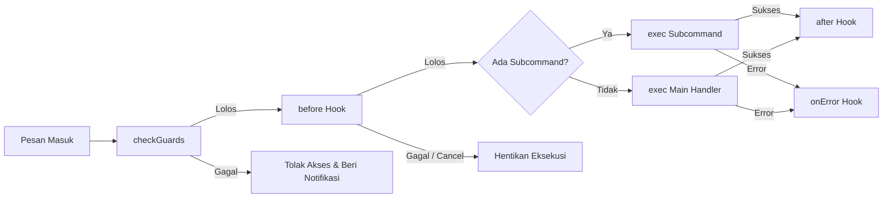

# 🧩 Arsitektur & Panduan Pembuatan Plugin (Plugin Engine)

Dokumen ini menjelaskan secara mendalam tentang **cara kerja, siklus hidup (*lifecycle*), akses kontrol (*guards*), dan panduan praktis** pembuatan modul plugin di dalam SuikaBot Starter.

---

## 📑 Daftar Isi
1. [Filosofi Desain](#1-filosofi-desain)
2. [Struktur Direktori & Auto-Discovery](#2-struktur-direktori--auto-discovery)
3. [Anatomi Standar Sebuah Plugin](#3-anatomi-standar-sebuah-plugin)
4. [Siklus Hidup Plugin (Lifecycle Pipeline)](#4-siklus-hidup-plugin-lifecycle-pipeline)
5. [Sistem Keamanan & Guards (Akses Kontrol)](#5-sistem-keamanan--guards-akses-kontrol)
6. [Fitur-Fitur Lanjutan](#6-fitur-fitur-lanjutan)
   - [Sub-Commands Modular](#a-sub-commands-modular)
   - [CLI Flags Parser Bawaan](#b-cli-flags-parser-bawaan)
   - [Non-Prefix Listeners & Custom Matcher](#c-non-prefix-listeners--custom-matcher)
   - [Hot-Reloading Tanpa Restart](#d-hot-reloading-tanpa-restart)
7. [Objek `m` (Serialized Message Actions)](#7-objek-m-serialized-message-actions)
8. [Objek `ctx` (Plugin Context)](#8-objek-ctx-plugin-context)
9. [Contoh-Contoh Implementasi Nyata](#9-contoh-contoh-implementasi-nyata)

---

## 1. Filosofi Desain

Plugin System di SuikaBot mengadopsi standar **Modern Modular File-based Routing** (terinspirasi dari Next.js dan Discord.js framework):
- **Zero-Config Loading**: Cukup buat satu file TypeScript di bawah folder `src/plugins/`, bot akan langsung memuat dan mendaftarkannya secara otomatis saat startup.
- **Isolated & Resilient**: Setiap plugin terisolasi. Jika terjadi error atau exception pada satu plugin, error tersebut ditangkap di tingkat engine sehingga tidak akan membuat proses bot *crash*.
- **Hot-Reloadable**: Mendukung pembaruan kode tanpa perlu mematikan koneksi WhatsApp atau merestart proses server.

---

## 2. Struktur Direktori & Auto-Discovery
 
Engine SuikaBot menerapkan standar **Strict Directory-Based Commands**: setiap perintah memiliki foldernya sendiri yang memuat file entry point `index.ts`.
 
```text
src/plugins/
├── _shared/                   # Private folder: Diabaikan oleh loader (shared helpers)
├── (admin)/                   # Route group: Folder pengelompokan tanpa mengubah nama command
│   └── group/                 # Command directory (.group)
│       ├── index.ts           # Router & entry point perintah utama (.group)
│       ├── open.ts            # Sub-command (.group open)
│       ├── close.ts           # Sub-command (.group close)
│       └── _helper.ts         # Private helper: Diabaikan dari auto-bind sub-command
├── (general)/                 # Route group
│   ├── ping/                  # Command directory (.ping)
│   │   └── index.ts           # Entry point perintah (.ping)
│   ├── info/                  # Command directory (.info)
│   │   ├── index.ts           # Entry point perintah (.info)
│   │   └── index.test.ts      # Co-located unit test
│   └── menu/                  # Command directory (.menu)
│       └── index.ts           # Entry point perintah (.menu)
└── (system)/                  # Route group
    └── reload/                # Command directory (.reload)
        └── index.ts           # Entry point perintah (.reload)
```
 
### 🔍 Aturan Auto-Discovery Engine:
1. **Command Directory**: Sebuah folder dianggap sebagai perintah bot jika memuat file `index.ts` (atau `main.ts`).
2. **Auto-Bound Sub-Commands**: File `.ts` yang berada sejajar di dalam folder command (selain `index.ts`, `*.test.ts`, dan `_*`) otomatis didaftarkan sebagai sub-command.
3. **Route Groups `(groupName)`**: Folder yang dibungkus tanda kurung `(groupName)` hanya berfungsi untuk pengelompokan file developer dan tidak memengaruhi trigger perintah.
4. **Private Folders & Files (`_folder/`, `_file.ts`)**: Folder atau file yang diawali garis bawah `_` diabaikan sepenuhnya oleh loader.
5. **Kategori di Tingkat File**: Pengelompokan tampilan di `.menu` WhatsApp **100% ditentukan oleh properti `category`** di dalam file plugin, bukan dari nama folder.
6. Setiap file **wajib mengekspor objek default (`export default`)** yang memenuhi interface `Plugin`.

---

## 3. Anatomi Standar Sebuah Plugin

Berikut adalah struktur dasar penulisan plugin:

```typescript
import type { Plugin } from '@/types/plugin';

const myPlugin: Plugin = {
  // Identitas Plugin
  name: 'contoh',                     // Nama perintah utama (dipanggil dengan .contoh)
  aliases: ['sample', 'testcmd'],     // Nama alias alternatif
  category: 'general',               // Kategori perintah (untuk pengelompokan di .menu)
  description: 'Contoh plugin sederhana',
  usage: '<teks opsional>',          // Panduan argumen perintah
  enabled: true,                     // Set false untuk menonaktifkan sementara tanpa hapus file

  // Handler Utama
  async exec(m, ctx) {
    await m.react('✨');
    await m.reply(`Halo ${m.senderName}! Anda mengetik: ${ctx.text || '(kosong)'}`);
  },
};

export default myPlugin;
```

---

## 4. Siklus Hidup Plugin (Lifecycle Pipeline)

Setiap pemanggilan perintah melewati pipeline 4 tahap:



### Tahapan Lifecycle:
1. **`checkGuards(plugin, m)`**: Memeriksa otorisasi (Whitelist `allowedJids`, `groupOnly`, `adminOnly`, dll.).
2. **`before?(m, ctx)`**: Dijalankan *sebelum* `exec`. Jika mengembalikan `false`, eksekusi dibatalkan (sangat berguna untuk validasi saldo/limit/cooldown).
3. **`exec(m, ctx)`**: Logika bisnis utama perintah.
4. **`after?(m, ctx, result)`**: Dijalankan *setelah* `exec` berhasil (berguna untuk analytics, audit log, atau pengurangan kuota).
5. **`onError?(err, m, ctx)`**: Penanganan khusus jika terjadi exception di dalam `exec`. Jika tidak didefinisikan, error ditangani oleh logger pusat.

---

## 5. Sistem Keamanan & Guards (Akses Kontrol)

Anda dapat mengamankan plugin hanya dengan menambahkan properti deklaratif:

| Guard Property | Tipe | Penjelasan |
| :--- | :--- | :--- |
| **`allowedJids`** | `string[]` | **Whitelist Pengguna / Grup**. Hanya nomor/JID yang ada di dalam list yang boleh mengeksekusi. Jika diisi `[]`, bot **memblokir semua orang**. |
| **`groupOnly`** | `boolean` | Membatasi perintah agar **hanya bisa dijalankan di dalam Grup WhatsApp**. |
| **`privateOnly`** | `boolean` | Membatasi perintah agar **hanya bisa dijalankan di Pesan Pribadi (DM)**. |
| **`adminOnly`** | `boolean` | Memerlukan pengirim pesan untuk menjadi **Admin Grup**. |
| **`botAdminOnly`** | `boolean` | Memerlukan akun bot untuk menjadi **Admin Grup** (misal untuk perintah `.kick`). |

> [!TIP]
> **Format Fleksibel `allowedJids`**:
> Anda bisa memasukkan nomor biasa (`'628123456789'`), JID WhatsApp (`'628123456789@s.whatsapp.net'`), LID (`'176475928023171@lid'`), atau JID Grup (`'120363111111111111@g.us'`).

---

## 6. Fitur-Fitur Lanjutan

### A. Sub-Commands Modular (Directory-Based Model & Next.js Hierarchy)

Standar pembuatan sub-command di SuikaBot mendukung 2 gaya sesuai kebutuhan:

#### 1. Flat Sibling Files (Untuk Sub-command Sederhana)
Setiap sub-perintah adalah 1 file `.ts` sejajar dengan `index.ts`:
```text
src/plugins/(admin)/group/
├── index.ts           # Perintah utama (.group) -> Help router
├── open.ts            # Sub-perintah (.group open / .group buka)
├── close.ts           # Sub-perintah (.group close / .group tutup)
└── kick.ts            # Sub-perintah (.group kick)
```

#### 2. Pure Next.js Nested Directories (Untuk Sub-command Kompleks / Bertingkat)
Setiap sub-perintah memiliki foldernya sendiri dengan `index.ts`, dan bisa memiliki sub-command lagi di dalamnya:
```text
src/plugins/(system)/config/
├── index.ts           # Perintah utama (.config)
└── database/          # Sub-perintah (.config database)
    ├── index.ts       # Handler .config database
    ├── _client.ts     # Helper privat database (diabaikan dari command)
    └── set/           # Sub-perintah tingkat kedua (.config database set)
        └── index.ts   # Handler .config database set
```

> ⚡ **Unified Plugin Interface**: Semua file (baik command utama maupun sub-command di level mana pun) menggunakan tipe yang sama: `export default { name: '...', exec: ... } satisfies Plugin`. Nama trigger perintah **100% ditentukan oleh properti `name` dan `aliases` di file tersebut**, bukan dari nama foldernya.

---

### B. CLI Flags Parser Bawaan
Engine otomatis mem-parsing flag bergaya CLI dari pesan teks pengguna:

```typescript
// Pengguna mengetik: .gemini jelaskan quantum computing --temp 0.7 --silent -f
async exec(m, ctx) {
  const temp = ctx.flags.get('temp');    // "0.7"
  const isSilent = ctx.flags.get('silent'); // true
  const isFast = ctx.flags.get('f');      // true
  const prompt = ctx.query;               // "jelaskan quantum computing"
}
```

---

### C. Non-Prefix Listeners & Custom Matcher
Plugin dapat merespons pesan **tanpa memerlukan prefix titik (`.`)**, misalnya untuk mendeteksi link otomatis (URL Auto-Downloader) atau keyword percakapan:

```typescript
import type { Plugin } from '@/types/plugin';

const tiktokDownloader: Plugin = {
  name: 'tiktok',
  category: 'downloader',
  description: 'Auto-download link TikTok',

  // Custom Matcher via RegExp
  customMatcher: /https?:\/\/(www\.|vm\.|vt\.)?tiktok\.com\/[^\s]+/i,

  async exec(m, ctx) {
    const url = m.body.match(/https?:\/\/(www\.|vm\.|vt\.)?tiktok\.com\/[^\s]+/i)?.[0];
    if (!url) return;

    await m.react('⏳');
    await m.reply(`📥 Mendeteksi link TikTok: ${url}\nSedang memproses...`);
  },
};

export default tiktokDownloader;
```

> Anda juga bisa menggunakan predikat fungsi untuk kondisi dinamis:  
> `customMatcher: (text, m) => text.toLowerCase().includes('halo bot')`

---

### D. Hot-Reloading Tanpa Restart
Anda bisa mengedit, menambah, atau menghapus file plugin saat bot sedang berjalan, kemudian mengeksekusi perintah hot-reload:

```
.reload
```

Engine akan memuat ulang seluruh modul plugin ke dalam memori seketika tanpa memutuskan koneksi WebSocket WhatsApp.

---

## 7. Objek `m` (Serialized Message Actions)

Objek `m` (`SerializedMessage`) menyediakan method aksi mandiri yang praktis:

| Method / Property | Tipe Return | Deskripsi |
| :--- | :--- | :--- |
| `m.reply(textOrContent)` | `Promise<proto.WebMessageInfo>` | Membalas pesan dengan teks atau media (`{ image: Buffer, caption: '...' }`). |
| `m.react(emoji)` | `Promise<proto.WebMessageInfo>` | Memberi reaksi emoji pada pesan (misal `m.react('⚡')`). |
| `m.showTyping()` | `Promise<void>` | Menampilkan indikator "sedang mengetik..." di chat. |
| `m.showRecording()` | `Promise<void>` | Menampilkan indikator "sedang merekam suara..." di chat. |
| `m.downloadMedia()` | `Promise<Buffer>` | Mengunduh file media lampiran (gambar, video, audio, stiker, dokumen). |
| `m.delete()` | `Promise<void>` | Menghapus pesan bot saat ini untuk semua orang (*delete for everyone*). |
| `m.edit(targetKey, newText)` | `Promise<proto.WebMessageInfo>` | Mengedit teks pesan bot yang sudah dikirim sebelumnya. |
| `m.quoted` | `QuotedMessage \| null` | Objek pesan yang di-reply/dikutip lengkap dengan method aksi mandiri (`m.quoted.downloadMedia()`, `m.quoted.react()`, `m.quoted.delete()`). |

---

## 8. Objek `ctx` (Plugin Context)

Objek `ctx` (`PluginContext`) memuat informasi pendukung eksekusi:

```typescript
export interface PluginContext {
  sock: WASocket;                        // Instance resmi koneksi Baileys WhatsApp
  config: BotConfig;                     // Konfigurasi aplikasi dari config.ts
  usedPrefix: string;                    // Prefix yang digunakan (misal: '.')
  command: string;                       // Nama command yang dipanggil (misal: 'info')
  args: string[];                        // Array argumen setelah command
  text: string;                          // Teks mentah argumen gabungan
  query: string;                         // Teks argumen bersih (trimmed)
  flags: Map<string, string | true>;     // Map parsing CLI flags (--flag / -f)
}
```

---

## 9. Contoh-Contoh Implementasi Nyata

### Contoh 1: Plugin Pembuat Stiker (`src/plugins/media/sticker.ts`)
```typescript
import type { Plugin } from '@/types/plugin';

const stickerPlugin: Plugin = {
  name: 'sticker',
  aliases: ['s', 'stiker'],
  category: 'media',
  description: 'Ubah gambar/video menjadi stiker WhatsApp',

  async exec(m) {
    // 1. Cek apakah ada media di pesan ini atau di pesan yang di-reply
    const target = m.isMedia ? m : m.quoted?.isMedia ? m.quoted : null;
    if (!target) {
      return m.reply('❌ Kirim atau reply gambar/video dengan caption `.sticker`');
    }

    await m.react('⏳');
    const buffer = await target.downloadMedia();

    // 2. Kirim balik sebagai stiker
    await m.reply({ sticker: buffer });
    await m.react('✅');
  },
};

export default stickerPlugin;
```

---

### Contoh 2: Plugin Eksekusi Kode Terbatas Whitelist (`src/plugins/system/eval.ts`)
```typescript
import type { Plugin } from '@/types/plugin';

const evalPlugin: Plugin = {
  name: 'eval',
  aliases: ['exec', '>'],
  category: 'system',
  description: 'Eksekusi kode JavaScript langsung (Akses Terbatas)',
  usage: '<kode JS>',
  
  // Hanya nomor di bawah ini yang bisa mengakses
  allowedJids: ['6285691947512'],

  async exec(m, ctx) {
    const code = m.text.trim();
    if (!code) return m.reply('Masukkan kode JavaScript yang ingin dieksekusi.');

    try {
      const { sock } = ctx;
      const formatted = /^\s*(?:return|const|let|var|if)\b/.test(code) ? code : `return (${code})`;
      const result = await eval(`(async () => { ${formatted} })()`);
      await m.reply(`*Output:*\n\`\`\`\n${typeof result === 'string' ? result : JSON.stringify(result, null, 2)}\n\`\`\``);
    } catch (err) {
      await m.reply(`❌ Error: ${err instanceof Error ? err.message : String(err)}`);
    }
  },
};

export default evalPlugin;
```
